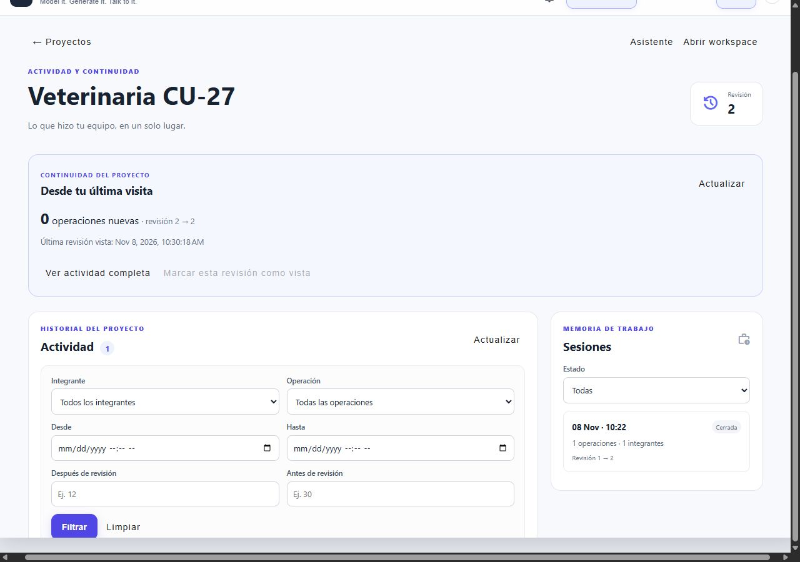

# Aceptación de Persona A y MongoDB

Fecha: 2026-11-08. Rama: `codex/activity-sessions`, basada en `tiago`.

## Verificación automatizada

| Comando | Resultado |
| --- | --- |
| `backend/gradlew.bat -p backend test bootJar` | 128 suites; 456 casos; 446 aprobados; 10 opt-in omitidos; 0 fallos/errores; JAR compilado |
| `npm run test:characterization` en `frontend` | 46/46 aprobados: generación 15, comandos 5, workspace 10, asistente 9, actividad/notificaciones 7 |
| `npm run build` en `frontend` | Compilación de producción correcta |
| `git diff --check` | Sin errores de espacios |

Se probaron transacciones en un replica set MongoDB real. Las suites cubren también reinicios
de la aplicación, conflictos concurrentes, aislamiento por usuario/proyecto, rollback y fallo del
broker con conservación del aviso. Las pruebas de importación verifican las ocho tablas legadas,
IDs, hashes de contraseña, documentos UML, secuencias del chat, colisiones e idempotencia.

Las diez pruebas opt-in omitidas son de aceptación IA externa y de ejecución de aplicaciones
generadas. Las pruebas ordinarias de esos módulos sí se ejecutaron. H2 se utiliza únicamente
en el importador offline y sus fixtures, y está ausente del JAR de ejecución.

## Migración real y persistencia

Se ejecutó la tarea `migrateLegacyDatabase` sobre `backend/data/classforge.mv.db`, destino
`classforge`. Resultado: 2 usuarios, 3 proyectos, 0 invitaciones y 0 membresías. La importación
leyó y verificó cada documento en una transacción antes de confirmar.

SHA-256 de la fuente: `9c340a1bf4c2acb3d2bb545ddd57a83138525d507257269dd4dc3cc56aa8d80c`.
El archivo original sigue disponible y se creó su copia `.before-mongo.bak`. La segunda
ejecución devolvió `alreadyImported: true`, sin duplicar datos. No se incluyen credenciales
ni contenido de proyectos en esta evidencia.

Se reinició exclusivamente el contenedor `classforge-mongo`. Después de recuperar estado
PRIMARY/healthy, la consulta a `classforge` confirmó de nuevo 2 usuarios, 3 proyectos y un
marcador de importación. Se conservó el volumen `classforge_classforge_mongo_data`.

## Aceptación en navegador con dos usuarios

Se utilizó una base demo aislada `cf_acceptance_20261108`, backend local en 18082 y frontend
en 14200. El propietario y el colaborador iniciaron sesión en orígenes separados, conservando
sesiones independientes. No se alteraron los tres proyectos habituales importados.

1. El propietario marcó la revisión 1 como vista. La tarjeta quedó sin novedades.
2. El colaborador creó `FacturaAuditoria` desde el workspace. El proyecto pasó a revisión 2.
3. El propietario recibió un aviso privado y contador 1 sin recargar. El autor mantuvo contador 0.
4. El Centro de actividad mostró actor, descripción y revisión 1 → 2. El filtro por el
   propietario mostró cero resultados y por el colaborador mostró la operación.
5. La tarjeta recuperó una novedad desde revisión 1. Consultarla no la consumió.
6. El propietario marcó el aviso individual como leído y el contador volvió a cero.
7. El detalle de sesión mostró participante, actividad y resumen. El propietario cerró la
   sesión; el colaborador recibió el aviso de cierre y pudo usar «marcar todas como leídas».
8. Desde móvil, el propietario marcó la revisión 2 como vista. Tras recargar, la tarjeta mostró
   cero novedades y revisión 2 → 2; el historial y la sesión cerrada permanecieron disponibles.

No se observaron errores en las consolas de los dos usuarios durante esta aceptación.

## Layouts y capturas

Las mediciones corresponden al documento real dentro de un iframe de dimensiones controladas;
el ancho útil descuenta 15 px de scrollbar vertical. `scrollWidth` fue igual a `clientWidth`
en los tres tamaños, sin desplazamiento horizontal.

| Frame | `clientWidth` | `scrollWidth` | Alto |
| --- | ---: | ---: | ---: |
| Teléfono 390 × 844 | 375 | 375 | 844 |
| Tablet 768 × 1024 | 753 | 753 | 1024 |
| Escritorio 1280 × 900 | 1265 | 1265 | 900 |

Capturas auténticas del navegador:

- [Actividad en escritorio](activity-desktop.jpg).
- [Actividad en tablet](activity-tablet.jpg).
- [Actividad en teléfono](activity-mobile.jpg).
- [Panel de notificaciones](notifications-desktop.jpg).

Se conserva [responsive-harness.html](responsive-harness.html) para repetir la medición: copiar
temporalmente a `frontend/public`, ejecutar la demo, iniciar sesión y abrir esa ruta. El harness
usa el proyecto fijo del fixture demo. La copia temporal se retiró de `frontend/public` al terminar.

