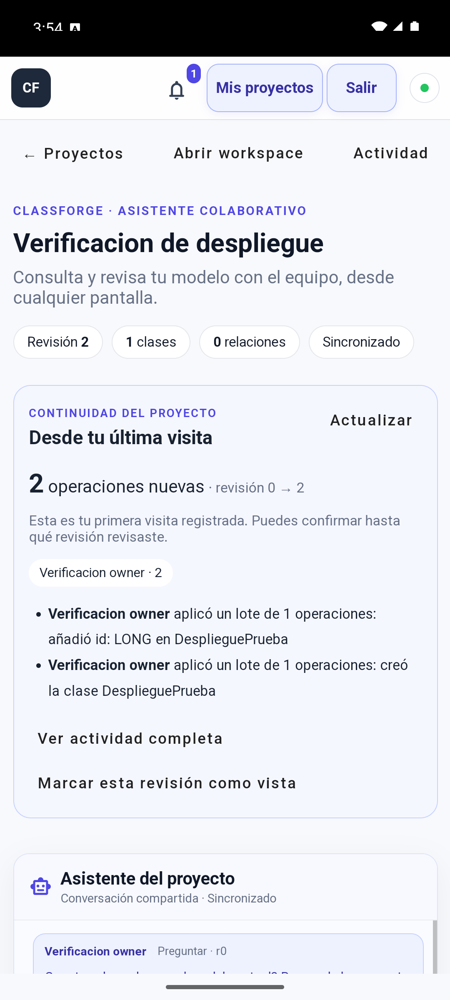

# APK Android conectado — evidencia

Fecha: 10 de noviembre de 2026. Rama `tiago`, implementación en `40fce0e` y
`1603014`. Cliente TWA, sin cambios al JAR/API Angular/Java desplegado.

## Artefacto publicado

- [APK firmado 1.0.0](https://classforge-tiago-15124.eastus.cloudapp.azure.com/android/classforge.apk),
  paquete `com.classforge.app`, versionCode 1, mínimo API 24/Android 7, target API 36.
- Tamaño: 3779943 bytes.
- SHA256 del APK:

```text
44515c175532872c9be23b978b4cbc2dd32c120056277b0429213b653dd75484
```

- SHA256 del certificado de firma:

```text
60:7A:9B:40:A5:13:45:F2:9F:57:EA:C3:EA:67:8E:A9:7B:CE:8F:1B:FC:9E:18:E4:E9:B5:FE:B9:39:19:67:30
```

- [Asociación DAL](https://classforge-tiago-15124.eastus.cloudapp.azure.com/.well-known/assetlinks.json)
  pública 200/JSON, exclusivamente ese paquete y certificado.
- [Metadatos](https://classforge-tiago-15124.eastus.cloudapp.azure.com/android/release.json)
  y [checksum](https://classforge-tiago-15124.eastus.cloudapp.azure.com/android/classforge.apk.sha256).
- APK descargado desde Azure idéntico al compilado; MIME Android APK y descarga
  como attachment. Firma privada, contraseñas y SDK fuera de Git/servidor público.

## Compilación y pruebas automáticas

- JDK 21.0.13, Gradle 8.13 con checksum fijado, AGP 8.13.2, SDK 36/Build Tools 35.0.0,
  Android Browser Helper 2.7.4; sin modificación del Java/Flutter global.
- Contrato de release Node: 6/6 aprobados, con RED→GREEN observado. Rechaza huellas
  y paquetes inválidos, APK alterado, publicación incompleta, origen diferente,
  firma/DAL inconsistentes y delegaciones adicionales.
- `assembleRelease` y `lintRelease` aprobados. apksigner valida firma real;
  aapt confirma paquete, versión y SDK. Escaneo del APK sin secretos configurados
  de Groq/Mongo/JWT ni contraseña de firma o archivos privados.
- Prueba instrumentada `LaunchSmokeTest` sobre el release, en Android 15/API 35:
  RED con excepción por `ManageDataLauncherActivity` no declarado; se agregó el
  componente oficial, y GREEN 1/1 comprobó arranque en Chrome sin crash.
- `pm get-app-links com.classforge.app` informa dominio **verified** y certificado
  correcto. UI TWA sin barra de dirección de Chrome.
- Revisión independiente del diff: sin hallazgos Critical/Important/Minor. Las
  comprobaciones de UI siguientes se realizaron aparte de la revisión estática.

## Pruebas reales en Android

Emulador dedicado `ClassForgeReleaseQA`, Android 15 Google APIs Play Store,
1080x2400/411dp, Chrome 124.0.6367.219. El usuario completó manualmente la
bienvenida/Términos de Chrome. Se usaron solo cuentas/proyecto sintéticos.

- Instalación del APK y login con cuenta existente, sin configurar IP/API/secretos
  en el teléfono. Se abrió el proyecto de Atlas y se mostró `Sincronizado`.
- Modelo/revisión previamente creados desde la web disponibles en Android.
- Solicitud EDIT desde el APK a Groq real: añadir `id: LONG · ID` a la clase de
  verificación. Mostró preview y conservó revisión 1 hasta pulsar Aplicar.
- Aplicar desde Android guardó revisión 2. Un segundo usuario conectado por STOMP
  autenticado recibió la operación WSS y leyó el identificador persistido en Atlas.
  Se comprobó presencia simultánea de ambos usuarios.
- Navegación Atrás a proyectos, reapertura y vista Asistente móvil correctas.
- Exportación XMI descargó archivo de 1576 bytes al almacenamiento de descargas.
- La exportación Spring primero rechazó correctamente el modelo sin identificador.
  Tras completar el ID mediante la propuesta, descargó ZIP de 326456 bytes.
  Se abrió el ZIP y se verificaron API/OpenAPI, Angular y Flutter incluidos.
- Selector Android de archivos: se eligió una imagen de prueba desde Downloads;
  la preparación/preview funcionó y Groq real devolvió `Análisis completo` con
  Aplicar/Descartar. Se descartó la propuesta; el modelo válido siguió en revisión 2.



## Publicación y límites

nginx sirve solo cuatro rutas públicas Android mediante un snippet y release
versionado; `nginx -t`/reload y smoke público original aprobados (health, rutas
profundas, API privada 401 y handshake WSS). No se reinició Java, cambió la base,
añadieron credenciales al APK ni se abrieron puertos nuevos.

La IP administrativa cambió durante la tarea. El usuario actualizó manualmente
la regla SSH /32 y se reanudó la publicación; no se abrió SSH a Any.

No se comprobó micrófono físico ni se hizo una regresión manual de cada diálogo
UML, combinación de generación Auth o gesto en cada marca/modelo Android. La voz
se conserva mediante las APIs del navegador; su backend Groq/WAV ya fue probado
en el despliegue web. Esta prueba Android no habilitó micrófono del equipo anfitrión.
Requiere Internet y navegador compatible. No se publicó en Play Store, no se
promete offline ni notificaciones push nuevas.

La herramienta general de control visual no pudo iniciar su runtime. Para QA
se utilizaron el Android SDK/CLI oficiales y una prueba instrumentada UIAutomator;
no se omiten verificaciones de TLS o confianza de dominio para hacer pasar la TWA.

La [guía Android](../../runtime/android-app.md) explica instalación, conservación
de firma, compilación, actualización y publicación reproducibles.
