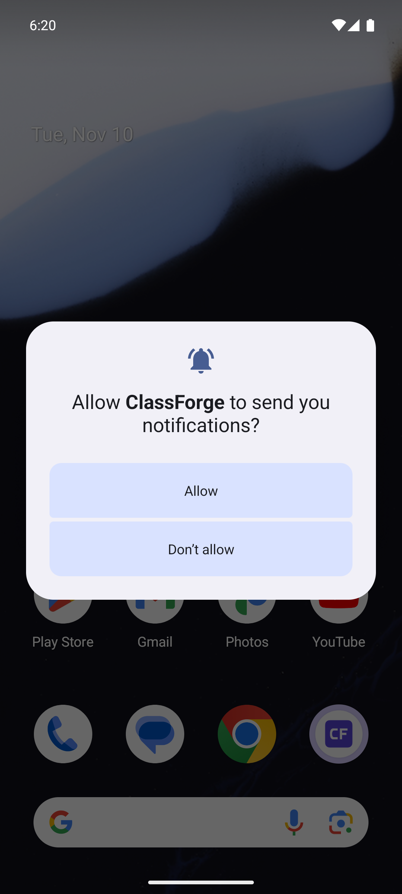
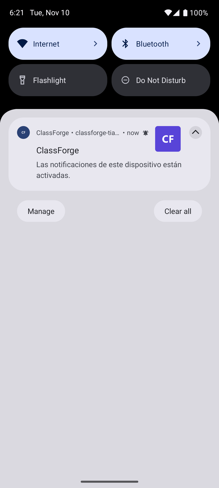

# Corrección de permisos y proveedor — APK 1.1.2

## Reporte e investigación

Se reportó pérdida de la suscripción tras el primer aviso en un Samsung S20 FE,
Android 13, One UI 5.1. Los registros mostraron aceptación 202 de la API y 201 de
FCM. Identificar solo el motor Chromium llevó inicialmente a atribuir las
peticiones a Chrome; la familia del agente confirmó **Samsung Internet**.
El APK anterior seleccionaba automáticamente el navegador preferido del teléfono.

Además se reprodujo el mismo síntoma con Chrome en el emulador tras una instalación
limpia: se concedieron los permisos del sitio y Chrome, pero ClassForge seguía
con `POST_NOTIFICATIONS=false`. Después del envío aceptado, la inspección de las
APIs públicas del navegador mostró `permission=denied` y `subscribed=false`.
La aceptación del proveedor no había confirmado la presentación en Android.

## Cambio

- APK 1.1.2/código 4, mismo paquete `com.classforge.app` y misma firma.
- Proveedor fijado en `com.android.chrome` con metadatos oficiales de ABH 2.7.4.
- Antes de abrir TWA, si falta el permiso nativo en Android 13+, se muestra una
  explicación con activación explícita u opción de continuar sin avisos.
- Permiso ya concedido y Android anterior a 13 mantienen el arranque directo.
- Rechazar, omitir o cancelar no bloquea el uso de la aplicación.
- El panel detecta suscripción local ausente y limpia el estado activo del
  dispositivo, en vez de sugerir que el usuario la desactivó.

## Verificación

- Reproducción RED del selector automático; GREEN con Chrome fijado.
- Reproducción RED de falta de permiso nativo antes de abrir el navegador.
- Instrumentación release: selección del proveedor y arranque con permiso;
  ejecuciones separadas para omitir, denegar y rotar con el permiso pendiente.
  Todas aprobadas. Las variantes negativas requieren una instalación limpia.
- Caracterización frontend completa aprobada; 18 pruebas específicas de push.
- Compilación release, Android Lint, firma, DAL y publicación aprobadas.
- Prueba real del APK 1.1.2 con permiso nativo concedido antes de Chrome: llegó
  el aviso en segundo plano y al tocarlo abrió ClassForge.
- Después de recibirlo, la inspección del navegador seguía mostrando
  `permission=granted` y `subscribed=true`.
- Artefactos y fuente inspeccionados sin valores privados de configuración ni
  material privado de firma.





APK SHA256:

```text
a9b2eaef7566abc1efc9f7aac6c395aacdc4f2f5680397262a9a1a4562db030a
```

JAR web publicado (SHA256):

```text
e1e30a86bc8688f67b5d012b2f84bd0d360a8c784fe990ff1359f06198fcd381
```

Estas verificaciones se realizaron en el emulador Android 15/Chrome 124. La
recepción en el Samsung físico sigue pendiente de confirmación del usuario.
No se afirma que todos los teléfonos Samsung tengan la misma causa ni que la
aceptación 201 del proveedor equivalga a recepción en el dispositivo.
