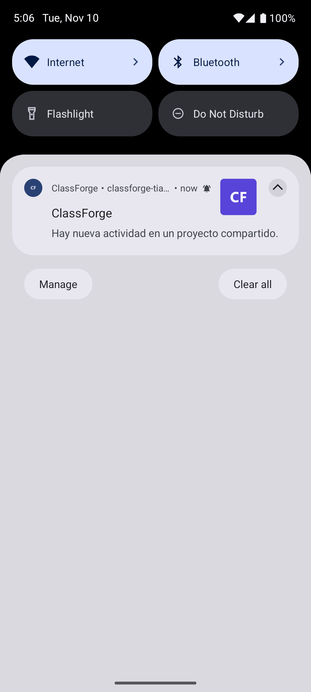
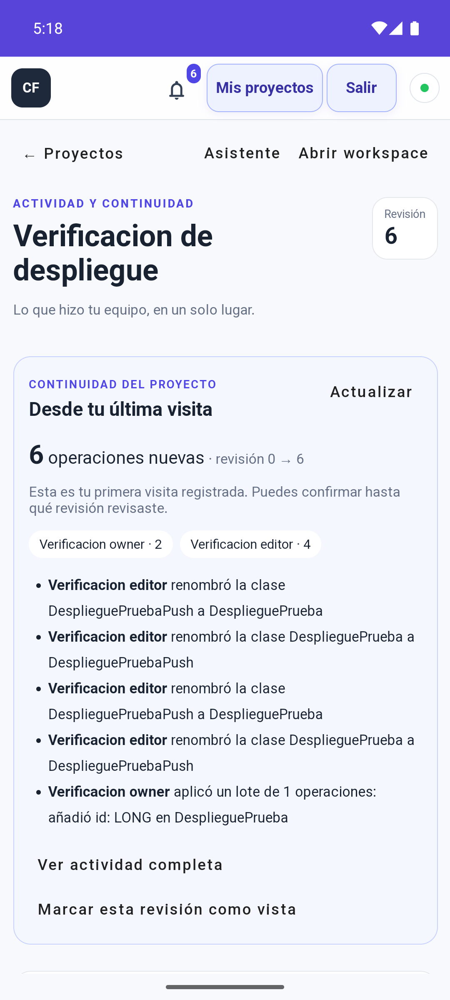

# Push web y Android — 2026-11-10

Publicación en la VM Azure existente, con MongoDB Atlas y el mismo origen HTTPS.
APK **1.1.0**, código 2, paquete `com.classforge.app`, firma conservada.

## Evidencia real

Dispositivo: emulador Android 15/API 35, Chrome 124, APK release firmado. Se usaron
únicamente las dos cuentas sintéticas y el proyecto de verificación del despliegue.

1. La campana mostró el control de activación. Android pidió permiso para
   **ClassForge**; se concedió y el dispositivo confirmó la suscripción.
2. **Enviar aviso de prueba** produjo una notificación real en Android mediante
   Web Push/FCM. No se simuló la recepción con una llamada local al worker.
3. Con ClassForge en segundo plano mediante Home, un editor autenticado modificó
   el proyecto. La operación se persistió y llegó a dos clientes WSS autenticados;
   Android recibió el aviso genérico de actividad.
4. El toque del aviso abrió dentro del APK la actividad del proyecto y mostró la
   revisión 6. Se verificó el código del worker instalado antes de esta prueba.
5. Al desactivar push, otra edición se guardó y apareció en la campana; el panel
   de Android indicó **No notifications**.
6. Tras reactivar para probar la apertura, se cerró sesión desde **Salir**. La
   pantalla volvió a mostrar **Ingresar**; dos operaciones posteriores no
   produjeron notificaciones del dispositivo.

El contenido del modelo sintético quedó restaurado; su revisión final es 8 por
las operaciones de prueba. La verificación de dominio Android figura como
`verified`, con el mismo certificado de la instalación anterior.





## Comprobaciones automatizadas

- Backend completo: 535 pruebas, 525 aprobadas, 10 opcionales omitidas, 0 fallos.
- Frontend: caracterización completa aprobada; 16 pruebas específicas de push.
- APK: assembleRelease, Android Lint, firma y contrato de release aprobados.
- Instrumentación del APK release en Android 15: 1 prueba aprobada.
- Regresiones RED→GREEN: aislamiento del planificador respecto a WSS, solapamiento
  de push/logout, cambio de cuenta sin red, orden de foco/navegación, navegación
  rechazada/nula y apertura con cliente oculto.
- Revisión independiente sin bloqueos pendientes tras corregir las carreras de
  sesión y la navegación desde notificaciones.
- Smoke público: salud, rutas Angular, API privada401 y handshake WSS correctos.
- Descarga pública del APK y asociación DAL comprobadas contra la firma real.

APK SHA256:

```text
61bbd6094c8a49f4e4cbfe68aee41690ed7d3f2532a1db88aaa5d3d5f8d435b5
```

JAR completo publicado (SHA256):

```text
7d17bb4aa58d51cb6e9c28a871d2257b80c6514976197fe7de6373ae31095cc6
```

El worker público coincide byte por byte con el fuente final. La configuración
privada VAPID se conserva fuera de Git y el entorno remoto mantiene permisos0600.
La inspección de927 entradas del JAR,403 del APK y del fuente versionado no
encontró los valores privados de configuración ni material de firma privado.

## Alcance

Se comprobó entrega real en segundo plano y apertura al tocar el aviso. No se
probó entrega con Chrome forzado a detenerse, sin conexión o con restricciones
de batería del fabricante. Tampoco se afirma entrega garantizada en todo
dispositivo. Mantener el navegador actualizado y permitir notificaciones.

Los avisos cubren las notificaciones existentes de actividad y sesión cerrada;
el escenario real anterior usa actividad. La configuración, bajas, cuotas,
reintentos, seguridad y operación se describen en el
[runbook push](../../runtime/push-notifications.md).
